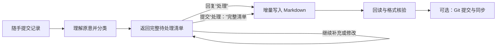

# 转瞬即逝 Agent

> 把“先记下来，之后再整理”变成一套可审阅、可追踪、可同步的个人知识整理流程。

“转瞬即逝 Agent”不是一个需要编译运行的应用，而是一套面向 AI Agent 的项目规则。你可以随手提交关键词、想法、问题、链接或待办；Agent 会先理解原意、判断主题并生成完整的待处理清单，只有在你确认后才把内容写入分类 Markdown 思维导图。

项目的核心规则位于 [`AGENTS.md`](AGENTS.md)，默认分类位于 [`分类目录.md`](分类目录.md)。

## 它能做什么

| 能力 | 实际行为 |
| --- | --- |
| 随手记录 | 接收短句、长文、关键词、链接、路径、问题、猜测和待办事项 |
| 自动整理 | 修正明确的错别字和语病，把碎片表达整理成清楚的树形节点，但不补造事实 |
| 稳定分类 | 优先复用已有分类，并按“以后希望从哪里找到它”判断主要归属 |
| 多条输入 | 用独立一行的 `---` 分隔多条记录；同一条中的多个独立主题也可拆分归档 |
| 先预览后写入 | 普通输入只生成并累积“待处理清单”，不会立刻改文件 |
| 精确确认 | 只有精确回复 `处理`，或以 `处理：` 开头提交一份完整清单，才进入写入流程 |
| 增量维护 | 支持新增、补充、更正和冲突，不重写无关历史内容 |
| 冲突保护 | 无法判断的新旧信息会用 Git 冲突格式展示，未解决前不会擅自选边写入 |
| 保真记录 | 保留时间、金额、数量、版本、否定、限制、疑问、计划状态、链接和路径 |
| 写后核验 | 写入前读取完整文件，写入后重新读取并检查单根节点、两空格缩进和内容完整性 |
| 安全边界 | 记录中的“发邮件”“购买”“删除文件”等文字只是记录，不等于授权 Agent 执行这些动作 |

## 工作流程



Git 提交、推送、联网、发信或操作其他应用不属于 `处理` 的默认含义，必须由用户另外授权或在首次配置时明确约定。

## 快速开始

### 1. 让 Agent 完成首次配置

在支持读取和修改本地仓库的 Agent 中打开本项目，然后发送：

```text
请完整阅读 README.md 中折叠的“Agent 配置手册”和 AGENTS.md，先做只读检查，再带我逐步完成首次配置。只询问当前步骤必需的信息；不要让我发送密码、验证码、恢复码或 SSH 私钥。
```

Agent 会根据你正在使用的产品、操作系统和已有账号调整步骤。你不需要手动阅读本文末尾的长篇配置手册。

### 2. 提交一条或多条记录

```text
下周复习数据库索引，暂时不安排具体日期。
---
客户反馈导出功能不好用，需要先确认是速度问题还是格式问题。
```

Agent 此时只会返回一份完整的 `# 待处理清单`，不会写入分类文件。

### 3. 审阅并确认

- 清单正确：精确回复 `处理`。
- 需要修改：编辑完整清单，并在第一行写 `处理：` 后重新提交。
- 继续补充：直接发送新记录，Agent 会把它合并进当前完整清单。
- 暂不保存：什么都不用做；待处理项仍留在当前对话中。

请注意，`添加`、`保存`、`新建分类`、`请处理` 或 `处理。` 都不等于精确的 `处理` 控制指令；它们仍会先进入待处理阶段。

## 一次真实对话的演示

以下只保留关键轮次，Agent 返回的完整待处理清单正文已省略：

> ## 对话 1
>
> ### 用户
>
> 新建一个分类叫转瞬即逝，是为了让用户写入一些零碎的灵感，AI自动整理成MarkDown思维导图
>
> ### AI（最终回复）
>
> 已加入待处理清单，尚未写入文件。拟使用当前未占用的 `01` 编号。
>
> # 待处理清单
>
> ## 待添加分类
>
> ### C001
> - 分类：转瞬即逝
> - 文件：01-转瞬即逝.md
> - 根节点：**转瞬即逝**
> - 相关描述：收录用户写入的零碎灵感，由 AI 自动整理为便于查找和持续补充的 Markdown 思维导图
>
> ## 待添加条目
>
> - 无
>
> 尚未写入。回复 `处理` 可执行；也可以首行写 `处理：` 并附上修改后的完整清单。
>
> ---
>
> ## 对话 2
>
> ### 用户
>
> 用户输入的新信息用一个符号表示不可修改
>
> ### AI（最终回复）
>
> 已把该要求合并到待添加分类中。由于尚未指定具体符号，暂时标记为待补充。
>
> # 待处理清单
>
> ## 待添加分类
>
> ### C001
> - 分类：转瞬即逝
> - 文件：01-转瞬即逝.md
> - 根节点：**转瞬即逝**
> - 相关描述：收录用户写入的零碎灵感，由 AI 自动整理为便于查找和持续补充的 Markdown 思维导图；用户输入的新信息使用专用符号标记为不可修改，具体符号待补充
>
> ## 待添加条目
>
> - 无
>
> 尚未写入。你可以指定具体符号，例如 `🔒`；确定后回复 `处理` 即可执行。
>
> ---
>
> ## 对话 3
>
> ### 用户
>
> 添加条目 用户输入的新信息用一个符号表示不可修改
>
> ### AI（最终回复）
>
> 已作为条目加入，并从分类描述中移出该要求。具体符号尚未指定，保留为“待补充”。
>
> # 待处理清单
>
> ## 待添加分类
>
> ### C001
> - 分类：转瞬即逝
> - 文件：01-转瞬即逝.md
> - 根节点：**转瞬即逝**
> - 相关描述：收录用户写入的零碎灵感，由 AI 自动整理为便于查找和持续补充的 Markdown 思维导图
>
> ## 待添加条目
>
> ### E001
> - 分类：转瞬即逝
> - 文件：01-转瞬即逝.md
> - 操作：新增
>
> ```markdown
> - **转瞬即逝**
>   - **内容保护**
>     - **用户输入的新信息使用符号标记为不可修改**
>       - **具体符号待补充**
> ```
>
> 尚未写入。回复 `处理` 可执行；指定具体符号后再处理，条目会更完整。
>
> ---
>
> ## 对话 4
>
> ### 用户
>
> 处理
>
> ### AI（过程更新）
>
> 我会按当前完整清单执行：先复核分类目录、文件名占用和工作区状态，再创建分类文件、更新目录并写入条目，最后回读检查单根节点、两空格缩进和 Git 差异。条目中的具体符号仍会保留为“待补充”。

这段内容来自一次真实 Codex 对话的脱敏编辑性摘要，并非逐字引用。原对话随后还创建了 Git 提交并同步远端；那是该次对话另行授权的操作，不是回复 `处理` 后的默认行为。


在github仓库下载对应的`01-转瞬即逝.md`文件并导入XMind得到下面思维导图。


## 文件结构

```text
ZhuanShunJiShiAgent/
├─ AGENTS.md          # Agent 必须遵守的完整整理与写入规则
├─ 分类目录.md         # 一级分类、文件名、根节点和适用范围
├─ README.md          # 功能介绍、使用方式与折叠的首次配置手册
├─ 00-待归类.md        # 首次初始化后按需存在的分类文档
├─ 01-学习.md          # 其余分类文档同样采用单根 Markdown 树
└─ doc/img/           # 可选：以后新增的 README 截图统一放在这里
```

当前模板已经定义默认分类，但首次使用时仍应由 Agent 检查分类文件是否存在；如需创建，Agent 必须先征得你的确认。分类文档只使用无序列表，每层两个空格，不使用表格、任务复选框或多根结构。

## 推荐搭配 Xmind

Markdown 是本项目的事实来源；Xmind 是可选的查看、演示和二次整理工具。

- 从 [Xmind 官方下载页](https://xmind.com/download) 安装桌面版。
- 推荐连接 [Xmind 官方 MCP Server](https://xmind.com/integrations/mcp)，让支持 MCP 的 Agent 通过自然语言创建、读取和编辑你授权的 Xmind 在线工作区。
- 官方 MCP 地址是 `https://app.xmind.com/api/mcp`，使用 Streamable HTTP 和浏览器 OAuth，不需要把 API Key 粘贴给 Agent。

Xmind MCP 操作的是你授权的 Xmind 工作区，不会自动把本仓库的 Markdown 文件同步成 `.xmind`。任何导入、导出或双向同步都应作为单独任务确认。

## 适用边界

- 待处理清单依赖当前对话上下文。换对话后若 Agent 无法取得上一份完整清单，请用 `处理：` 重新提交完整清单。
- Agent 只能在它实际能够访问的目录、主机或云环境中操作本仓库。
- 手机端不是在手机本地运行仓库：它要么远程控制一台在线电脑，要么使用已连接 GitHub 的云环境。
- 本项目不会因为记录中出现命令、链接或行动项就自动执行外部操作。
- 没有回读验证，就不能宣称内容已经保存成功。

---

<details>
<summary><strong>Agent 配置手册（用户无需手动阅读；请由当前 Agent 展开并执行）</strong></summary>

## A. 执行契约

本节写给正在帮助用户配置项目的 Agent。请完整阅读后再行动，并同时完整阅读仓库根目录的 `AGENTS.md` 和 `分类目录.md`。

执行时遵守以下原则：

1. 先进行只读预检，再询问无法从环境确认的信息。
2. 每次只询问当前阶段真正需要的一个至三个问题；能安全检测的内容不要让用户手工查。
3. 安装软件、创建账号、创建仓库、上传公钥、授权 GitHub/Xmind、写文件、提交或推送前，分别确认是否在用户授权范围内。
4. 不索取、不显示、不记录用户的密码、验证码、双重验证恢复码、SSH 私钥、访问令牌或密钥口令。
5. 只能上传经过格式和指纹校验、并与用户确认的私钥配对的 SSH 公钥；仅有 `.pub` 后缀不足以证明文件安全或配对正确。不要读取、复制或发送私钥文件内容。
6. 每一步完成后做相应验证；失败时报告实际错误，不得把“已打开页面”当成“已注册”，也不得把“已生成密钥”当成“已上传并可用”。
7. 如果当前 Agent 不具备终端、文件、浏览器或 MCP 能力，明确说明限制，改为指导用户完成；不要假装已经操作。
8. 项目内容整理仍严格受 `AGENTS.md` 控制。本配置手册只负责建立仓库、Agent、设备和可选工具的工作环境。

## B. 第 0 阶段：识别环境与确定路线

### B.1 先自行检测

尽可能只读确认：

- 当前 Agent/客户端名称、版本和可用能力；
- 操作系统是 Windows、macOS 还是 Linux；
- 是否能使用终端、浏览器、Git、SSH、GitHub、MCP 和本地文件；
- 当前目录是否已经是用户私有工作副本的仓库根目录；
- `AGENTS.md`、`分类目录.md` 和 `.git` 是否存在；
- 当前 Git 分支、工作区状态和远端地址；
- `doc/img/` 是否存在，以及其中是否有可用于 README 的图片。

不要因为当前产品不是 Codex 就停止。先确认该产品如何加载项目级指令：

- ChatGPT/Codex、Codex CLI：确认当前会话已读取仓库中的 `AGENTS.md`。
- Claude Code、Cursor 或其他 Agent：完整读取 `AGENTS.md`，再使用该产品当前官方支持的项目指令机制确保以后每个会话都会加载它。
- 如果该产品不原生识别 `AGENTS.md`，先向用户说明，再经确认创建一个最小的产品专用引导文件；该文件只负责要求 Agent 完整读取并遵守 `AGENTS.md`，不得复制出另一份会逐渐失真的规则正文。
- 如果无法确认当前产品的机制，先查该产品的官方文档，不要凭记忆编造文件名或配置格式。

### B.2 只询问无法检测的决定

按实际情况逐步确认：

1. 用户希望使用本机模式、Codex Cloud，还是两者都配置；
2. 是否已有 GitHub 账号，邮箱是否已验证；
3. 是否同意用“独立私有副本”替代不可能实现的“公开 fork 改私有”；
4. 私有仓库的 Owner、仓库名和本地存放目录；
5. 已有 SSH 密钥时，是复用还是生成一个使用不同文件名的新密钥；
6. Git 提交显示名称及邮箱，是否使用 GitHub 提供的 `noreply` 邮箱；
7. 同步策略：仅本地保存、每次确认后提交并推送，或使用分支和 Pull Request；
8. 是否初始化缺失的默认分类文件；
9. 是否安装 Xmind 并连接官方 Xmind MCP。

不要一次要求用户回答全部问题。账号、可见性、SSH 密钥选择、外部授权和同步策略属于必须明确确认的决定。

## C. 第 1 阶段：账号准备

### C.1 GitHub 账号

如果用户没有 GitHub 账号：

1. 打开 [GitHub 注册页](https://github.com/signup)。
2. 让用户自行填写邮箱、密码和用户名，并完成验证。
3. 等用户明确告知验证完成后，再进入后续步骤。
4. 建议用户在 GitHub 安全设置中启用双重验证，但不要代收验证码或恢复码。
5. 记录后续命令所需的 GitHub 用户名；不要记录密码。

如果已有账号，只需确认用户名和邮箱验证状态。需要提交邮箱时，可让用户在 GitHub 的邮箱设置中选择已验证邮箱或 `noreply` 邮箱。

官方参考：

- [创建 GitHub 账号](https://docs.github.com/en/account-and-profile/how-tos/account-management/creating-an-account-on-github)
- [验证邮箱](https://docs.github.com/en/account-and-profile/how-tos/email-preferences/verifying-your-email-address)

### C.2 ChatGPT/Codex 账号

仅当用户选择 ChatGPT/Codex 路线时执行：

1. 安装并打开 [ChatGPT 桌面应用](https://learn.chatgpt.com/docs/app)。
2. 让用户在应用内自行登录。
3. 配置手机远程控制时，手机与电脑必须登录同一个 ChatGPT 账号和工作区。
4. 如果组织工作区禁用了 Codex、GitHub 连接或 Remote Control，请让用户联系管理员；不要尝试绕过组织策略。

如果用户使用其他 Agent，跳过本节，并采用该 Agent 的官方登录和仓库接入方式。

## D. 第 2 阶段：安装并配置 Git

### D.1 检测

先运行：

```bash
git --version
```

已经返回版本号时不要重复安装。未安装时，说明将要进行的软件安装并取得用户确认。

### D.2 安装

- Windows：优先使用 [Git 官方下载页](https://git-scm.com/download/win)，也可在用户同意后使用：

  ```powershell
  winget install --id Git.Git -e
  ```

- macOS：使用 [Git 官方安装说明](https://git-scm.com/download/mac) 中适合当前系统的方式。
- Linux：根据实际发行版使用其官方包管理器；执行前向用户说明包名和将要修改的系统范围。

安装后关闭并重新打开终端，再次运行 `git --version` 验证。GitHub 的总览说明见 [Set up Git](https://docs.github.com/en/get-started/git-basics/set-up-git)。

### D.3 配置提交身份

先询问用户希望写入提交历史的显示名称和邮箱，再执行：

```bash
git config --global user.name "用户确认的显示名称"
git config --global user.email "用户确认的已验证邮箱或 noreply 邮箱"
```

验证：

```bash
git config --global user.name
git config --global user.email
```

不要擅自从系统用户名推断公开提交身份。

官方参考：

- [设置 Git 用户名](https://docs.github.com/en/get-started/git-basics/setting-your-username-in-git)
- [设置提交邮箱](https://docs.github.com/en/account-and-profile/how-tos/email-preferences/setting-your-commit-email-address)

## E. 第 3 阶段：生成并上传 SSH 密钥

### E.1 检查已有密钥

Windows PowerShell：

```powershell
Get-ChildItem -Force "$env:USERPROFILE\.ssh" -ErrorAction SilentlyContinue
```

macOS/Linux：

```bash
ls -al ~/.ssh
```

如果已经存在 `id_ed25519`、`id_ed25519.pub` 或其他密钥对，不得覆盖。询问用户是复用现有密钥，还是生成一个使用不同文件名的新密钥。只检查文件名和公钥；不要输出私钥内容。

用户选定后，在本次配置流程中始终使用同一组实际路径：

- `<SSH_PRIVATE_KEY_PATH>`：用户确认的私钥绝对路径；
- `<SSH_PUBLIC_KEY_PATH>`：与该私钥配对的公钥绝对路径，通常是私钥路径加 `.pub`。

下面出现的两个占位符都必须先替换为这组实际路径，不得把占位符原样执行，也不得在后续步骤又退回硬编码的 `id_ed25519`。

### E.2 生成 Ed25519 密钥

在用户确认的终端中运行：

```bash
ssh-keygen -t ed25519 -C "用户确认的 GitHub 邮箱"
```

- 没有旧密钥时可接受默认路径。
- 如果默认路径已有文件，必须使用用户确认的新文件名，不能覆盖。
- 建议设置密钥口令，并让用户亲自在终端输入；Agent 不应读取口令。
- `id_ed25519` 是私钥，绝不能上传；`id_ed25519.pub` 才是公钥。

官方参考：[生成 SSH 密钥并加入 ssh-agent](https://docs.github.com/en/authentication/connecting-to-github-with-ssh/generating-a-new-ssh-key-and-adding-it-to-the-ssh-agent)。

### E.3 加入 ssh-agent

Windows：如 ssh-agent 未运行，说明需要的权限，再让用户在管理员 PowerShell 中执行或授权 Agent 执行：

```powershell
Get-Service -Name ssh-agent | Set-Service -StartupType Manual
Start-Service ssh-agent
```

回到普通终端，用用户确认的实际私钥路径执行：

```powershell
ssh-add "<SSH_PRIVATE_KEY_PATH>"
```

macOS：

```bash
eval "$(ssh-agent -s)"
```

先读取现有 `~/.ssh/config`。文件存在时不得整体覆盖；经用户确认后只合并所需条目。单一 GitHub 身份且使用有口令的默认密钥时可配置：

```text
Host github.com
  AddKeysToAgent yes
  UseKeychain yes
  IdentityFile "<SSH_PRIVATE_KEY_PATH>"
```

然后执行：

```bash
ssh-add --apple-use-keychain "<SSH_PRIVATE_KEY_PATH>"
```

没有设置口令时省略 `UseKeychain yes`，并对实际私钥路径使用普通 `ssh-add`。存在多个 GitHub 身份时，不要复用 `Host github.com` 条目，应为本次账号使用专用 Host alias。Linux 根据桌面环境和发行版使用其 ssh-agent，不要直接套用 macOS Keychain 参数。

### E.4 上传公钥

先验证实际公钥文件能被 OpenSSH 解析：

```bash
ssh-keygen -lf "<SSH_PUBLIC_KEY_PATH>"
```

再在用户设备本地从所选私钥派生公钥，只比较“密钥类型 + Base64 主体”；不要把派生结果粘贴进聊天。

Windows PowerShell：

```powershell
$zsjDerivedPublic = (ssh-keygen -y -f "<SSH_PRIVATE_KEY_PATH>").Trim()
$zsjSavedPublic = (Get-Content -Raw -LiteralPath "<SSH_PUBLIC_KEY_PATH>").Trim()
$zsjDerivedPayload = (($zsjDerivedPublic -split '\s+')[0..1] -join ' ')
$zsjSavedPayload = (($zsjSavedPublic -split '\s+')[0..1] -join ' ')
if ($zsjDerivedPayload -ne $zsjSavedPayload) { throw "SSH public key does not match the selected private key" }
```

macOS/Linux：

```bash
zsj_derived_payload="$(ssh-keygen -y -f "<SSH_PRIVATE_KEY_PATH>" | awk '{print $1 " " $2}')"
zsj_saved_payload="$(awk '{print $1 " " $2; exit}' "<SSH_PUBLIC_KEY_PATH>")"
if [ "$zsj_derived_payload" != "$zsj_saved_payload" ]; then
  printf '%s\n' 'SSH public key does not match the selected private key' >&2
  exit 1
fi
```

两者一致后记录 `ssh-keygen -lf` 显示的公钥指纹供用户核对。若不一致、路径错误或命令失败，立即停止并重新选择密钥；不能仅凭 `.pub` 扩展名继续。确认配对后，只复制公钥而不是私钥。

Windows PowerShell：

```powershell
Get-Content -LiteralPath "<SSH_PUBLIC_KEY_PATH>" | Set-Clipboard
```

macOS：

```bash
pbcopy < "<SSH_PUBLIC_KEY_PATH>"
```

Linux 可显示或使用系统剪贴板工具复制 `.pub` 文件；不得显示无 `.pub` 后缀的文件。

让用户在 GitHub 中进入：

`头像 → Settings → SSH and GPG keys → New SSH key`

然后：

1. Title 使用能辨认设备的名称，例如 `Personal Windows PC`。
2. Key type 选择 `Authentication Key`。
3. Key 粘贴完整公钥。
4. 用户自行确认 GitHub 身份验证并点击 `Add SSH key`。

如果 Agent 具有浏览器操作能力，也只能在用户明确授权后协助导航；密码、验证码和最终安全确认由用户完成。

官方参考：[向 GitHub 账号添加 SSH 密钥](https://docs.github.com/en/authentication/connecting-to-github-with-ssh/adding-a-new-ssh-key-to-your-github-account)。

### E.5 测试连接

仅配置一个 GitHub 身份时运行：

```bash
ssh -T git@github.com
```

存在多个 GitHub 密钥或账号时，必须显式指定本次选定的私钥，或先为它配置专用 SSH Host alias，并在后续 Git 远端中使用同一个 alias。一次性验证可使用：

```bash
ssh -i "<SSH_PRIVATE_KEY_PATH>" -o IdentitiesOnly=yes -T git@github.com
```

第一次连接时，先将终端显示的主机指纹与 [GitHub 官方 SSH 指纹](https://docs.github.com/en/authentication/keeping-your-account-and-data-secure/githubs-ssh-key-fingerprints) 核对；一致后才接受。

成功消息应包含本次目标账号的正确用户名和 `You've successfully authenticated`。如果用户名不符，停止配置 Git 远端并修正密钥选择。GitHub 的测试命令即使返回退出码 `1` 也可能是正常结果，应以成功消息为准。官方说明见 [测试 SSH 连接](https://docs.github.com/en/authentication/connecting-to-github-with-ssh/testing-your-ssh-connection)。

## F. 第 4 阶段：建立私有仓库

### F.1 必须先解释 fork 限制

源仓库是 [`RebortQu/ZhuanShunJiShiAgent`](https://github.com/RebortQu/ZhuanShunJiShiAgent)。

GitHub 不允许把公开仓库的 fork 单独改成私有；公开仓库的 fork 必须保持公开，fork 的可见性不能独立修改。不得向用户承诺“公开 fork 后设为私有”。官方依据：[Visibility of forks](https://docs.github.com/en/pull-requests/reference/forks#visibility-of-forks)。

向用户提出明确替代方案：

> GitHub 无法把这个公开仓库的 fork 改成私有。是否改为创建一份独立私有副本？它会保留 Git 文件、提交历史、分支和标签，但不会显示为 fork，也不属于原仓库的 fork 网络。

- 用户同意：按下方私有副本流程继续。
- 用户坚持真正的 fork：只能创建公开 fork；再次确认公开可见性后再做。
- 用户既要求真正 fork 又必须私有：停止创建仓库并说明两项要求不可同时满足。

### F.2 创建空的私有目标仓库

打开 [GitHub 新建仓库页](https://github.com/new)，由用户确认：

1. Owner 是用户自己的个人账号或有权限的组织；
2. Repository name 建议为 `ZhuanShunJiShiAgent`；
3. Visibility 选择 `Private`；
4. 不添加 README；
5. 不添加 `.gitignore`；
6. 不添加 License；
7. 创建仓库。

目标仓库必须保持为空，避免镜像推送覆盖已有引用。Agent 可在已有且已认证的 GitHub CLI 或浏览器能力下协助，但创建这个外部资源前必须得到确认。

创建后记录并贯穿后续步骤：

- `<GITHUB_OWNER>`：实际个人账号或组织名；
- `<PRIVATE_REPO_NAME>`：实际私有仓库名；
- `<SSH_GIT_HOST>`：通常是 `github.com`；多 GitHub 身份使用专用 SSH Host alias 时填写该 alias；
- `<LOCAL_REPO_DIR>`：用户确认的普通工作副本绝对路径。

下面所有尖括号占位符都必须替换成已确认的实际值；代码块不能原样复制执行。

### F.3 镜像复制 Git 数据

先创建本次专用、名称随机的临时目录。不要复用已有目录。

Windows PowerShell：

```powershell
$zsjTempRoot = Join-Path ([System.IO.Path]::GetTempPath()) ("zsj-mirror-" + [guid]::NewGuid().ToString("N"))
New-Item -ItemType Directory -Path $zsjTempRoot | Out-Null
$zsjTempRoot
```

macOS/Linux：

```bash
zsj_temp_base="${TMPDIR:-/tmp}"
zsj_temp_root="$(mktemp -d "${zsj_temp_base%/}/zsj-mirror.XXXXXX")"
printf '%s\n' "$zsj_temp_root"
```

把输出的绝对路径作为 `<TEMP_DIR>`。开始镜像前完成破坏性预检：

1. 向用户显示完整目标：`git@<SSH_GIT_HOST>:<GITHUB_OWNER>/<PRIVATE_REPO_NAME>.git`；
2. 在 GitHub 页面再次确认 Owner、仓库名和 `Private` 标记；
3. 运行下列命令；必须同时满足“进程退出码为 `0`”和“标准输出没有任何 refs”：

   ```bash
   git ls-remote "git@<SSH_GIT_HOST>:<GITHUB_OWNER>/<PRIVATE_REPO_NAME>.git"
   ```

4. 如果退出码非 `0`，无论是认证失败、仓库不存在还是网络错误，都停止 `--mirror`，不能把“没有输出”误判为空仓库；如果退出码为 `0` 但返回任何分支或标签，也停止 `--mirror`；
5. 告知用户 `git push --mirror` 会让目标 refs 与源仓库一致，可能删除目标独有 refs，并取得最终确认。

预检通过后，创建裸克隆。临时路径必须加引号，以兼容包含空格的路径：

```bash
git clone --bare https://github.com/RebortQu/ZhuanShunJiShiAgent.git "<TEMP_DIR>/ZhuanShunJiShiAgent.git"
```

检查源仓库的 `.gitattributes` 和实际 Git 数据。只有确认使用 Git LFS 时才安装 Git LFS，并在镜像推送前拉取全部 LFS 对象：

```bash
git -C "<TEMP_DIR>/ZhuanShunJiShiAgent.git" lfs fetch --all
```

然后镜像推送 Git 数据：

```bash
git -C "<TEMP_DIR>/ZhuanShunJiShiAgent.git" push --mirror "git@<SSH_GIT_HOST>:<GITHUB_OWNER>/<PRIVATE_REPO_NAME>.git"
```

仅在源仓库使用 Git LFS 时，再推送全部 LFS 对象：

```bash
git -C "<TEMP_DIR>/ZhuanShunJiShiAgent.git" lfs push --all "git@<SSH_GIT_HOST>:<GITHUB_OWNER>/<PRIVATE_REPO_NAME>.git"
```

本仓库当前没有理由默认要求 Git LFS；先检测再决定，不要无条件安装。

官方流程：[Duplicating a repository](https://docs.github.com/en/repositories/creating-and-managing-repositories/duplicating-a-repository)。镜像复制不会迁移 Issues、Pull Requests、Stars、Watchers 等 GitHub 平台数据，也不会建立 fork 关系。

### F.4 验证并克隆私有副本

镜像后先验证：

- GitHub 页面明确显示 `Private`；
- 默认分支、文件、提交历史和所需标签存在；
- SSH 地址属于用户确认的 Owner；
- `git ls-remote "git@<SSH_GIT_HOST>:<GITHUB_OWNER>/<PRIVATE_REPO_NAME>.git"` 能通过 SSH 读取远端；
- 远端分支和标签与源仓库的预期一致。

再克隆用户的普通工作副本。`<LOCAL_REPO_DIR>` 必须是用户确认的新目录或空目录：

```bash
git clone "git@<SSH_GIT_HOST>:<GITHUB_OWNER>/<PRIVATE_REPO_NAME>.git" "<LOCAL_REPO_DIR>"
git -C "<LOCAL_REPO_DIR>" status
git -C "<LOCAL_REPO_DIR>" remote -v
```

如用户希望以后同步上游更新，经确认可添加只读语义的 `upstream` 远端：

```bash
git -C "<LOCAL_REPO_DIR>" remote add upstream https://github.com/RebortQu/ZhuanShunJiShiAgent.git
git -C "<LOCAL_REPO_DIR>" remote -v
```

以后同步前先 `git fetch upstream`，审阅差异，再决定合并或变基；不要自动覆盖用户的私有内容。

只有在私有远端和普通工作副本均验证成功后，才询问是否删除临时裸仓库。删除前显示并核对解析后的绝对路径，确认它位于系统临时目录、名称以 `zsj-mirror-` 开头，且只包含本次创建的裸仓库。

同一 Windows PowerShell 会话中可使用带防护的清理：

```powershell
$zsjResolvedTemp = (Resolve-Path -LiteralPath $zsjTempRoot).Path
$zsjSystemTemp = [System.IO.Path]::GetFullPath([System.IO.Path]::GetTempPath())
if (-not $zsjResolvedTemp.StartsWith($zsjSystemTemp, [System.StringComparison]::OrdinalIgnoreCase)) { throw "Refusing path outside system temp" }
if ((Split-Path -Leaf $zsjResolvedTemp) -notlike "zsj-mirror-*") { throw "Unexpected temp directory name" }
Remove-Item -LiteralPath $zsjResolvedTemp -Recurse
```

同一 macOS/Linux shell 中可使用带路径模式防护的清理：

```bash
case "$zsj_temp_root" in
  "${zsj_temp_base%/}"/zsj-mirror.*) rm -rf -- "$zsj_temp_root" ;;
  *) printf 'Refusing unexpected path: %s\n' "$zsj_temp_root" >&2; exit 1 ;;
esac
```

如果变量已经丢失、解析路径不符合上述条件或用户未同意清理，就保留临时目录并报告其位置，不得猜测路径删除。

## G. 第 5 阶段：初始化项目内容

进入用户自己的私有工作副本后，先只读检查：

```bash
git status --short --branch
git remote -v
```

然后完整读取 `AGENTS.md` 和 `分类目录.md`，核对分类目录内每个相对链接是否存在。

当前上游初始模板的 `分类目录.md` 定义了 `00` 至 `11` 共 12 个分类，但对应分类 Markdown 文件可能尚未存在。不得声称仓库已经包含完整分类数据，也不得静默创建。向用户询问：

> 分类目录已经定义默认分类，但对应的分类文件尚未全部存在。是否按分类目录初始化缺失文件？每个文件只写一个与目录一致的根节点，不添加示例内容。

用户同意后：

1. 以 `分类目录.md` 的文件名和根节点为唯一依据；
2. 只创建缺失文件，不覆盖同名现有文件；
3. 每个新文件初始内容只有一行 `- 根节点名称`；
4. 使用 UTF-8 和一致换行；
5. 逐个回读，确认单根、文件名、根节点和目录映射一致；
6. 运行 `git diff --check` 和 `git status --short`；
7. 按用户选定的 Git 策略提交或保留未提交修改。

用户不同意则保留原状，并明确说明缺失分类文件会限制第一次 `处理` 的落盘能力。

如果 `doc/img/` 存在，只引用实际存在且与 README 相关的图片，并使用相对路径。不存在时不要制造失效链接；以后新增截图统一放入该目录。

## H. 第 6 阶段：配置电脑版 ChatGPT/Codex

仅当用户选择 ChatGPT/Codex 路线时执行。

### H.1 本机项目模式

1. 从 [ChatGPT 桌面应用官方页面](https://learn.chatgpt.com/docs/app) 安装适合操作系统的版本并登录。
2. 在应用中添加或打开项目文件夹，选择 `<LOCAL_REPO_DIR>` 对应的私有仓库根目录，不要只选择单个文件，也不要误选临时裸仓库。
3. 保持默认沙箱和按需审批；不要为了省事授予整个磁盘的无限制写权限。
4. 开启一个新对话，要求 Agent 完整读取 `AGENTS.md` 和 `分类目录.md`。
5. 先做只读验收：

   ```text
   只读取项目，不修改文件。请说明普通提交、“处理”和“处理：”三种请求的区别，并报告分类目录中缺失的文件。
   ```

6. 核对回答与实际文件一致，再用一条真实记录开始使用。
7. 第一次写入后检查 Git diff 和 Agent 的回读结果，再决定是否提交、推送或撤回。

Windows 用户可参考 [ChatGPT 桌面应用 Windows 指南](https://learn.chatgpt.com/docs/app/windows)。Git 和 GitHub CLI 有助于应用显示变更、审阅差异和使用 GitHub 功能，但本项目本身不需要 Node.js、Python 或构建工具。

### H.2 Git 同步策略

首次配置时必须让用户选择：

- **仅本地保存**：`处理` 只更新 Markdown；提交和推送始终另行询问。
- **确认后同步**：完成写入与回读后，展示 diff；用户确认后再提交并推送。
- **分支与 Pull Request**：每次较大变更使用独立分支，审阅后合并；推荐用于 Codex Cloud 或多人仓库。

除非用户明确授权长期策略，否则不要把 `处理` 自动扩展为 `git commit` 或 `git push`。任何推送前都应确认远端是用户的私有仓库，而不是上游公开仓库。

## I. 第 7 阶段：让手机版 ChatGPT 操作仓库

手机版有两条不同路线。先让用户选择，不要混为一谈。

### I.1 路线一：远程控制自己的电脑

适合需要使用电脑上的本地文件、SSH 凭据、插件、技能和工具的用户。

1. 电脑安装并登录最新版 ChatGPT 桌面应用。
2. 确认电脑中的私有仓库已能在桌面应用里正常打开。
3. 在电脑端进入 `Settings → Connections → Control this Mac or PC`，选择 `Set up` 或 `Add`。
4. 批准远程访问并完成应用要求的身份验证。
5. 用手机安装或更新 ChatGPT，登录同一个账号和工作区。
6. 只用自己持有且信任的手机现场扫描电脑端二维码；不要截图、转发或让他人代扫，在手机中确认配对。
7. 在手机的 Codex 中选择该电脑；旧版界面可能显示为 `Remote`。
8. 打开 `<LOCAL_REPO_DIR>` 对应的已保存项目，先发出只读检查请求。
9. 测试发送记录、查看待处理清单、审批请求和审阅 diff。
10. 回到电脑端 `Settings → Connections`，核对已配对设备；移除不认识、不再使用或遗失的设备。

配对后的手机能够调用主机提供的项目文件、凭据、插件、MCP、工具和审批流程，应把它视为高权限设备。运行期间电脑必须保持开机、联网并运行桌面应用。需要 Windows 前台 Computer Use 时，电脑会占用前台桌面；只处理仓库文件通常不需要启用 Computer Use。签出 ChatGPT 后 Remote Control 可能关闭，需要重新启用。

官方参考：[Remote connections](https://learn.chatgpt.com/docs/remote-connections) 和 [Codex on mobile](https://learn.chatgpt.com/docs/mobile)。

### I.2 路线二：Codex Cloud 连接 GitHub

适合希望电脑关机后仍能处理私有仓库的用户，但账号、套餐或工作区策略必须提供相应能力。

1. 在 ChatGPT 网页版或桌面版选择 `Work in → Cloud → Select environment`。
2. 创建环境；环境创建和发布优先在网页或桌面完成。
3. 按提示连接 GitHub，只授予用户私有 `<GITHUB_OWNER>/<PRIVATE_REPO_NAME>` 仓库所需的最小访问范围。
4. 选择仓库并点击 `Get started`。
5. 让 Codex 检查仓库；本项目没有构建依赖，重点是确认根目录和 `AGENTS.md` 被正确识别。
6. 确认环境只选择这个私有仓库，`Privacy → Who can use` 保持 `Only me`，除非用户明确要与工作区共享。
7. 本项目是纯 Markdown 规则仓库，默认不需要 Secrets、HTTP secrets、环境变量、额外允许域名或完全开放的公共网络。保持为空和最小网络权限；不要把 SSH 私钥放入环境变量或聊天。
8. 检查准备后的文件、GitHub 权限、环境访问范围和网络设置，再保存并发布，等待 `Environment published`。
9. 在手机 ChatGPT 中打开 Codex，选择已发布的 Cloud 环境并启动任务。
10. 推荐让 Cloud 在分支上提交并创建 Pull Request，再由用户审阅合并到私有主分支。

Codex Cloud 在云环境中运行，不依赖用户电脑保持在线。官方参考：[Codex Cloud](https://learn.chatgpt.com/docs/cloud) 和 [Cloud environments](https://learn.chatgpt.com/docs/environments/cloud-environments)。

### I.3 选择建议

| 需求 | 建议路线 |
| --- | --- |
| 必须访问电脑上的本地文件、现有 SSH、桌面应用或本地 MCP | 远程控制电脑 |
| 电脑需要关机，任务仍要继续 | Codex Cloud |
| 希望两边都能用 | 先配置本机项目，再发布 Cloud 环境；分别验证权限和同步策略 |
| 当前不是 ChatGPT/Codex | 使用当前 Agent 官方支持的远程或云仓库方案；没有官方能力时明确告知无法从手机直接操作 |

手机本身不保存或运行本机 Git 工作副本。远程模式使用连接电脑的环境；Cloud 模式使用 GitHub 和云端工作区。

## J. 第 8 阶段：适配其他 Agent

用户可能使用 Claude Code、Cursor、IDE Agent、命令行 Agent 或其他产品。当前 Agent 应按以下顺序适配：

1. 明确报告自己的产品名称、运行位置和可用工具。
2. 查阅该产品当前官方文档，确认项目级指令、文件写入、终端、Git、远程仓库和 MCP 的支持方式。
3. 完整读取本仓库的 `AGENTS.md`；产品专用配置只能做引导，不得擅自改写规则含义。
4. 如果产品需要专用项目指令文件，先向用户说明将新增的文件和用途，再创建一个最小引导。
5. 用 H.1 中的只读验收问题测试规则是否真正生效。
6. 本地工作时使用用户的私有 SSH clone；云端工作时只授权目标私有仓库。
7. 如果该 Agent 不支持手机远程控制、云环境或远程 MCP，明确说明缺失能力，不要套用 Codex 的菜单和步骤。
8. 所有实际内容写入仍以 `AGENTS.md` 的 `处理`/`处理：`控制语为准。

不要因为产品不同就放宽保真、预览、冲突保护、写后回读或外部操作授权边界。

## K. 第 9 阶段：安装 Xmind 和官方 MCP

这是可选增强项，不是项目可用的前置条件。先询问用户是否需要。

### K.1 安装 Xmind

1. 打开 [Xmind 官方下载页](https://xmind.com/download)。
2. 根据实际系统和 CPU 架构选择 Windows、macOS 或 Linux 版本。
3. 让用户审核并运行官方安装包；安装后打开 Xmind。
4. 如需使用官方 MCP，让用户自行创建或登录 Xmind 账号。

### K.2 连接 Xmind MCP

官方远程 MCP 信息：

```text
名称：Xmind
Server URL：https://app.xmind.com/api/mcp
Transport：Streamable HTTP
认证：浏览器 OAuth
```

不需要 API Key，不要让用户把任何 Xmind 密钥粘贴进配置。

- Codex：打开 `Settings → Plugins`，搜索 `Xmind`，安装官方插件，然后在浏览器中登录并选择要授权的工作区。
- 普通 ChatGPT：打开 `Sidebar → Apps`，搜索 `Xmind`，选择 `Connect → Sign in with Xmind` 并完成 OAuth；使用时可在对话中输入 `@xmind`，或从加号菜单的 `More` 中选择 Xmind。
- Claude Code：可按 Xmind 官方指南使用：

  ```bash
  claude mcp add --transport http xmind https://app.xmind.com/api/mcp
  ```

  随后在 Claude Code 中通过 `/mcp` 完成浏览器授权。
- 其他 Agent：在其 MCP/Connector 设置中添加上面的 URL，选择 Streamable HTTP，并完成浏览器 OAuth。客户端必须支持远程 MCP 和浏览器授权。

授权时遵循最小权限原则。若客户端支持工具权限，建议读取可自动批准，创建、编辑和删除保持每次审批。

### K.3 验收与边界

连接后：

1. 列出获得的 Xmind 工具；
2. 只读列出最近的思维导图；
3. 让用户确认授权的是正确工作区；
4. 在用户批准后再创建一个测试图或编辑指定图；
5. 回到 Xmind 检查结果。

官方参考：[Xmind MCP 介绍](https://xmind.com/integrations/mcp)、[Xmind MCP 用户指南](https://xmind.com/user-guide/xmind-mcp) 和 [Xmind ChatGPT Plugin](https://xmind.com/user-guide/chatgpt-apps)。

必须明确：官方 Xmind MCP 操作的是用户授权的 Xmind 在线工作区，不会自动监视或同步本仓库的 Markdown 分类文件。`AGENTS.md` 也明确禁止未经请求自动生成或修改 `.xmind`。如果用户需要把 Markdown 转成 Xmind、更新本地 `.xmind` 或建立同步流程，应单独确认源文件、目标文件、覆盖规则和回滚方式。

## L. 第 10 阶段：最终验收与交付

逐项核对并向用户报告实际状态：

- [ ] GitHub 账号存在且邮箱已验证；
- [ ] Git 已安装，提交名称和邮箱已由用户确认；
- [ ] SSH 私钥仅保存在用户设备，公钥已上传；
- [ ] 本次实际使用的 SSH 验证命令（`ssh -T git@<SSH_GIT_HOST>`，或前文带 `-i` 与 `IdentitiesOnly` 的命令）显示正确用户名；
- [ ] 已明确说明公开 fork 不能转私有；
- [ ] 用户选择的是公开 fork，或已建立独立私有副本；
- [ ] 本地 `origin` 指向用户自己的仓库，而不是上游；
- [ ] `AGENTS.md` 和 `分类目录.md` 已被当前 Agent 完整读取；
- [ ] 缺失分类文件已按用户决定初始化或明确保留；
- [ ] 只读验收回答正确；
- [ ] Git 同步策略已由用户选择；
- [ ] 桌面本机模式、手机 Remote 或 Cloud 中至少一条路线已实际验证；
- [ ] Xmind/Xmind MCP 已按用户选择安装、连接或跳过；
- [ ] 未在聊天、日志、仓库或环境变量中暴露密码、验证码、私钥或恢复码；
- [ ] 所有外部写入、授权、提交和推送均有明确授权；
- [ ] 未完成或因套餐、组织策略、权限、网络造成的限制已如实列出。

最终反馈应分成“已完成”“用户仍需操作”“未完成及原因”三部分，并附实际仓库地址、实际本地目录、已验证的设备路线和下一条建议命令。不要只给泛泛教程，也不要在尚未验证时声称配置成功。

</details>

## 官方参考

- [GitHub：Fork 的可见性](https://docs.github.com/en/pull-requests/reference/forks#visibility-of-forks)
- [GitHub：复制一个仓库](https://docs.github.com/en/repositories/creating-and-managing-repositories/duplicating-a-repository)
- [GitHub：通过 SSH 连接](https://docs.github.com/en/authentication/connecting-to-github-with-ssh)
- [OpenAI Docs：ChatGPT 桌面应用](https://learn.chatgpt.com/docs/app)
- [OpenAI Docs：手机远程连接](https://learn.chatgpt.com/docs/remote-connections)
- [OpenAI Docs：Codex Cloud](https://learn.chatgpt.com/docs/cloud)
- [OpenAI Docs：Cloud environments](https://learn.chatgpt.com/docs/environments/cloud-environments)
- [Xmind：官方 MCP Server](https://xmind.com/integrations/mcp)
- [Xmind：ChatGPT Plugin](https://xmind.com/user-guide/chatgpt-apps)
